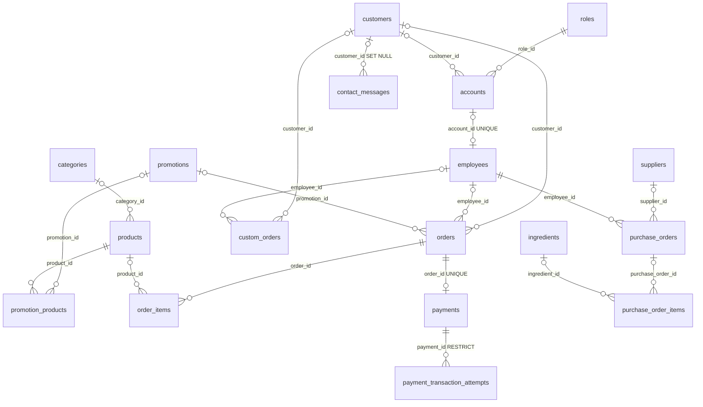

# ERD - He thong quan ly tiem banh ngot

> Tai lieu nay mo ta schema MySQL trong `quanlytiembanhngot_prod_candidate_aiven.sql`.
> File SQL la ban production candidate, can duoc review truoc khi import. ERD mo ta
> cau truc bang va quan he, khong khang dinh du lieu seed hay Flyway history da duoc
> ap dung vao database.

## Quy uoc

- Ten bang va cot dung `snake_case`; cac bang nghiep vu dung ten so nhieu.
- Khoa chinh cua cac bang co `id` la `BIGINT AUTO_INCREMENT`, tru bang lien ket
  `promotion_products` dung khoa chinh ghep.
- Kieu du lieu, tinh nullable, unique va quan he duoi day duoc doi chieu voi DDL,
  unique keys va foreign keys trong SQL candidate.
- `BIT(1)` la gia tri boolean o MySQL; `DATETIME(6)` luu thoi gian voi do chinh
  xac microsecond. Cac cot `DEFAULT NULL` cho phep gia tri NULL.
- MongoDB luu log/history o database rieng, khong nam trong ERD MySQL nay.

## So do quan he

`newsletter_subscriptions` khong co foreign key toi bang khac. `promotion_products`
la bang trung gian many-to-many giua `promotions` va `products`.

## Danh muc bang

### 1. Tai khoan va nhan su

#### `roles`
Vai tro tai khoan.

| Cot | Kieu du lieu | Rang buoc / ghi chu |
|---|---|---|
| `id` | BIGINT | PK, AUTO_INCREMENT |
| `description` | VARCHAR(255) | NULL |
| `name` | VARCHAR(100) | NULL |
| `role_code` | VARCHAR(50) | NULL; ma nghiep vu nhu `ADMIN`, `MANAGER`, `STAFF`, `CUSTOMER` |

#### `accounts`
Tai khoan dang nhap; email verification chi luu hash token.

| Cot | Kieu du lieu | Rang buoc / ghi chu |
|---|---|---|
| `id` | BIGINT | PK, AUTO_INCREMENT |
| `created_at` | DATETIME(6) | NULL |
| `email` | VARCHAR(100) | NULL, UNIQUE |
| `email_verification_token_expires_at` | DATETIME(6) | NULL |
| `email_verification_token_hash` | VARCHAR(64) | NULL, UNIQUE; hash token |
| `email_verified` | BIT(1) | NOT NULL |
| `password_hash` | VARCHAR(255) | NULL |
| `status` | VARCHAR(20) | NULL; trang thai tai khoan |
| `updated_at` | DATETIME(6) | NULL |
| `username` | VARCHAR(50) | NULL, UNIQUE |
| `customer_id` | BIGINT | NULL, FK -> `customers.id`, index `ix_accounts_customer_id` |
| `role_id` | BIGINT | NULL, FK -> `roles.id` |

#### `employees`
Ho so nhan vien; lien ket toi account la tuy chon va khong qua mot account cho
moi employee.

| Cot | Kieu du lieu | Rang buoc / ghi chu |
|---|---|---|
| `id` | BIGINT | PK, AUTO_INCREMENT |
| `email` | VARCHAR(100) | NULL |
| `full_name` | VARCHAR(100) | NULL |
| `phone` | VARCHAR(15) | NULL |
| `salary` | DECIMAL(15,2) | NULL |
| `status` | BIT(1) | NULL |
| `account_id` | BIGINT | NULL, UNIQUE, FK -> `accounts.id` |

Quan he: mot `role` co the gan cho nhieu `accounts`; mot `account` co toi da mot
`employee` do `employees.account_id` UNIQUE. `accounts.customer_id` la FK tuy
chon, nhung khong co UNIQUE constraint trong schema.

### 2. Khach hang va ho tro

#### `customers`

| Cot | Kieu du lieu | Rang buoc / ghi chu |
|---|---|---|
| `id` | BIGINT | PK, AUTO_INCREMENT |
| `address` | VARCHAR(255) | NULL |
| `email` | VARCHAR(100) | NULL |
| `full_name` | VARCHAR(100) | NULL |
| `loyalty_points` | INT | NULL |
| `phone` | VARCHAR(15) | NULL |
| `status` | BIT(1) | NULL |

#### `contact_messages`
Tin nhan tu trang lien he. Lien ket khach hang co the NULL; khi xoa customer,
FK dat `customer_id` ve NULL.

| Cot | Kieu du lieu | Rang buoc / ghi chu |
|---|---|---|
| `id` | BIGINT | PK, AUTO_INCREMENT |
| `created_at` | DATETIME(6) | NOT NULL; index `idx_contact_messages_created_at` |
| `customer_email` | VARCHAR(100) | NOT NULL |
| `message` | VARCHAR(3000) | NOT NULL |
| `customer_name` | VARCHAR(100) | NOT NULL |
| `status` | ENUM(`IN_PROGRESS`, `NEW`, `RESOLVED`) | NOT NULL; index ket hop voi `created_at` |
| `subject` | VARCHAR(120) | NOT NULL |
| `customer_id` | BIGINT | NULL, FK -> `customers.id` ON DELETE SET NULL; index |

#### `newsletter_subscriptions`
Email dang ky nhan ban tin; email la duy nhat.

| Cot | Kieu du lieu | Rang buoc / ghi chu |
|---|---|---|
| `id` | BIGINT | PK, AUTO_INCREMENT |
| `active` | BIT(1) | NOT NULL |
| `consented_at` | DATETIME(6) | NOT NULL |
| `email` | VARCHAR(100) | NOT NULL, UNIQUE |

### 3. Danh muc san pham va khuyen mai

#### `categories`

| Cot | Kieu du lieu | Rang buoc / ghi chu |
|---|---|---|
| `id` | BIGINT | PK, AUTO_INCREMENT |
| `description` | VARCHAR(255) | NULL |
| `name` | VARCHAR(100) | NULL |
| `status` | BIT(1) | NULL |

#### `products`

| Cot | Kieu du lieu | Rang buoc / ghi chu |
|---|---|---|
| `id` | BIGINT | PK, AUTO_INCREMENT |
| `created_at` | DATETIME(6) | NULL |
| `description` | TEXT | NULL |
| `expiry_date` | DATE | NULL |
| `image_url` | VARCHAR(500) | NULL |
| `name` | VARCHAR(150) | NULL |
| `price` | DECIMAL(15,2) | NULL |
| `product_code` | VARCHAR(30) | NULL |
| `quantity` | INT | NULL |
| `status` | BIT(1) | NULL |
| `unit` | VARCHAR(30) | NULL |
| `category_id` | BIGINT | NULL, FK -> `categories.id` |

#### `promotions`

| Cot | Kieu du lieu | Rang buoc / ghi chu |
|---|---|---|
| `id` | BIGINT | PK, AUTO_INCREMENT |
| `discount_percent` | DECIMAL(5,2) | NULL |
| `end_date` | DATE | NULL |
| `max_discount` | DECIMAL(15,2) | NULL |
| `min_order_value` | DECIMAL(15,2) | NULL |
| `name` | VARCHAR(100) | NULL |
| `promotion_code` | VARCHAR(30) | NULL, UNIQUE (`uk_promotions_promotion_code`) |
| `start_date` | DATE | NULL |
| `status` | BIT(1) | NULL |

#### `promotion_products`
Bang lien ket N-N; khoa chinh ghep theo dung thu tu DDL `(product_id, promotion_id)`.

| Cot | Kieu du lieu | Rang buoc / ghi chu |
|---|---|---|
| `product_id` | BIGINT | PK ghep, FK -> `products.id` |
| `promotion_id` | BIGINT | PK ghep, FK -> `promotions.id` |

### 4. Nguyen lieu va nhap hang

#### `ingredients`

| Cot | Kieu du lieu | Rang buoc / ghi chu |
|---|---|---|
| `id` | BIGINT | PK, AUTO_INCREMENT |
| `ingredient_code` | VARCHAR(30) | NULL |
| `min_stock_level` | DECIMAL(15,3) | NULL |
| `name` | VARCHAR(150) | NULL |
| `status` | BIT(1) | NULL |
| `stock_quantity` | DECIMAL(15,3) | NULL |
| `unit` | VARCHAR(30) | NULL |
| `unit_price` | DECIMAL(15,2) | NULL |

So luong ton hien tai duoc luu tren `ingredients`; schema nay khong co bang lo
nguyen lieu rieng.

#### `suppliers`

| Cot | Kieu du lieu | Rang buoc / ghi chu |
|---|---|---|
| `id` | BIGINT | PK, AUTO_INCREMENT |
| `address` | VARCHAR(255) | NULL |
| `email` | VARCHAR(100) | NULL |
| `name` | VARCHAR(150) | NULL |
| `phone` | VARCHAR(15) | NULL |
| `status` | BIT(1) | NULL |
| `supplier_code` | VARCHAR(30) | NULL |

#### `purchase_orders`
Phieu nhap hang; `employee_id` bat buoc theo SQL candidate.

| Cot | Kieu du lieu | Rang buoc / ghi chu |
|---|---|---|
| `id` | BIGINT | PK, AUTO_INCREMENT |
| `created_at` | DATETIME(6) | NULL |
| `employee_id` | BIGINT | NOT NULL, FK -> `employees.id` |
| `order_date` | DATETIME(6) | NULL |
| `purchase_code` | VARCHAR(30) | NULL |
| `status` | VARCHAR(30) | NULL; trang thai phieu nhap |
| `total_amount` | DECIMAL(15,2) | NULL |
| `supplier_id` | BIGINT | NULL, FK -> `suppliers.id` |

#### `purchase_order_items`

| Cot | Kieu du lieu | Rang buoc / ghi chu |
|---|---|---|
| `id` | BIGINT | PK, AUTO_INCREMENT |
| `line_total` | DECIMAL(15,2) | NULL |
| `quantity` | DECIMAL(15,3) | NULL |
| `unit_cost` | DECIMAL(15,2) | NULL |
| `ingredient_id` | BIGINT | NULL, FK -> `ingredients.id` |
| `purchase_order_id` | BIGINT | NULL, FK -> `purchase_orders.id` |

### 5. Don hang, chi tiet va thanh toan

#### `orders`

| Cot | Kieu du lieu | Rang buoc / ghi chu |
|---|---|---|
| `id` | BIGINT | PK, AUTO_INCREMENT |
| `created_at` | DATETIME(6) | NULL |
| `customer_request_key` | VARCHAR(36) | NULL; cung `customer_id` tao UNIQUE ghep |
| `delivery_address` | VARCHAR(255) | NULL |
| `delivery_status` | VARCHAR(30) | NULL |
| `discount_amount` | DECIMAL(15,2) | NULL |
| `note` | VARCHAR(500) | NULL |
| `order_code` | VARCHAR(30) | NULL |
| `order_date` | DATETIME(6) | NULL |
| `promotion_code_snapshot` | VARCHAR(30) | NULL; ma khuyen mai tai thoi diem dat |
| `status` | VARCHAR(30) | NULL; trang thai don hang |
| `stock_reserved` | BIT(1) | NOT NULL |
| `total_amount` | DECIMAL(15,2) | NULL; tong truoc giam |
| `customer_id` | BIGINT | NULL, FK -> `customers.id` |
| `employee_id` | BIGINT | NULL, FK -> `employees.id` |
| `promotion_id` | BIGINT | NULL, FK -> `promotions.id` |

UNIQUE ghep: (`customer_id`, `customer_request_key`) de ho tro idempotency.
`final_amount` khong luu trong bang; ung dung tinh tu `total_amount -
discount_amount`.

#### `order_items`

| Cot | Kieu du lieu | Rang buoc / ghi chu |
|---|---|---|
| `id` | BIGINT | PK, AUTO_INCREMENT |
| `discount_amount` | DECIMAL(15,2) | NULL |
| `line_total` | DECIMAL(15,2) | NULL |
| `quantity` | INT | NULL |
| `unit_price` | DECIMAL(15,2) | NULL |
| `order_id` | BIGINT | NULL, FK -> `orders.id` |
| `product_id` | BIGINT | NULL, FK -> `products.id` |

#### `payments`
Moi don co toi da mot payment; moi payment phai thuoc mot order.

| Cot | Kieu du lieu | Rang buoc / ghi chu |
|---|---|---|
| `id` | BIGINT | PK, AUTO_INCREMENT |
| `amount` | DECIMAL(15,2) | NULL |
| `paid_at` | DATETIME(6) | NULL |
| `payment_method` | VARCHAR(30) | NULL; vi du `CASH`, `VNPAY` |
| `provider` | VARCHAR(100) | NULL |
| `status` | VARCHAR(30) | NULL; trang thai thanh toan |
| `transaction_id` | VARCHAR(150) | NULL |
| `order_id` | BIGINT | NOT NULL, UNIQUE, FK -> `orders.id` |

#### `payment_transaction_attempts`
Luu tung lan thu/giao dich VNPay; tham chieu payment va khong cascade delete
(`ON DELETE RESTRICT`).

| Cot | Kieu du lieu | Rang buoc / ghi chu |
|---|---|---|
| `id` | BIGINT | PK, AUTO_INCREMENT |
| `amount_vnd` | BIGINT | NOT NULL; amount theo VND |
| `bank_code` | VARCHAR(20) | NULL |
| `completed_at` | DATETIME(6) | NULL |
| `created_at` | DATETIME(6) | NOT NULL |
| `provider_transaction_no` | VARCHAR(100) | NULL |
| `response_code` | VARCHAR(10) | NULL |
| `status` | VARCHAR(30) | NOT NULL |
| `transaction_date` | VARCHAR(14) | NULL |
| `transaction_status` | VARCHAR(10) | NULL |
| `txn_ref` | VARCHAR(100) | NOT NULL, UNIQUE |
| `updated_at` | DATETIME(6) | NOT NULL |
| `payment_id` | BIGINT | NOT NULL, FK -> `payments.id`; index `ix_payment_transaction_attempts_payment_id` |

### 6. Don dat banh theo yeu cau

#### `custom_orders`

| Cot | Kieu du lieu | Rang buoc / ghi chu |
|---|---|---|
| `id` | BIGINT | PK, AUTO_INCREMENT |
| `cake_name` | VARCHAR(150) | NULL |
| `delivery_date` | DATETIME(6) | NULL |
| `deposit` | DECIMAL(15,2) | NULL |
| `estimated_price` | DECIMAL(15,2) | NULL |
| `order_date` | DATETIME(6) | NULL |
| `request_description` | TEXT | NULL |
| `status` | VARCHAR(30) | NULL |
| `customer_id` | BIGINT | NULL, FK -> `customers.id` |
| `employee_id` | BIGINT | NULL, FK -> `employees.id` |

## Bang tong hop

| # | Bang | Nhom |
|---:|---|---|
| 1 | `roles` | Tai khoan va nhan su |
| 2 | `accounts` | Tai khoan va nhan su |
| 3 | `employees` | Tai khoan va nhan su |
| 4 | `customers` | Khach hang va ho tro |
| 5 | `contact_messages` | Khach hang va ho tro |
| 6 | `newsletter_subscriptions` | Khach hang va ho tro |
| 7 | `categories` | Danh muc san pham |
| 8 | `products` | Danh muc san pham |
| 9 | `promotions` | Khuyen mai |
| 10 | `promotion_products` | Khuyen mai |
| 11 | `ingredients` | Nguyen lieu va nhap hang |
| 12 | `suppliers` | Nguyen lieu va nhap hang |
| 13 | `purchase_orders` | Nguyen lieu va nhap hang |
| 14 | `purchase_order_items` | Nguyen lieu va nhap hang |
| 15 | `orders` | Don hang va thanh toan |
| 16 | `order_items` | Don hang va thanh toan |
| 17 | `payments` | Don hang va thanh toan |
| 18 | `payment_transaction_attempts` | Don hang va thanh toan |
| 19 | `custom_orders` | Don dat banh theo yeu cau |

## Ngoai pham vi ERD MySQL

- `activity_logs` va `order_status_histories` la document collections trong
  MongoDB Atlas, khong phai bang MySQL.
- `flyway_schema_history` la bang quan ly migration cua Flyway, khong phai bang
  nghiep vu.
- SQL candidate ghi ro la ban review, khong co Flyway history va da loai bo mot
  so du lieu test/giao dich. Kiem tra ke hoach migration va schema thuc te truoc
  khi import vao database dang dung.
